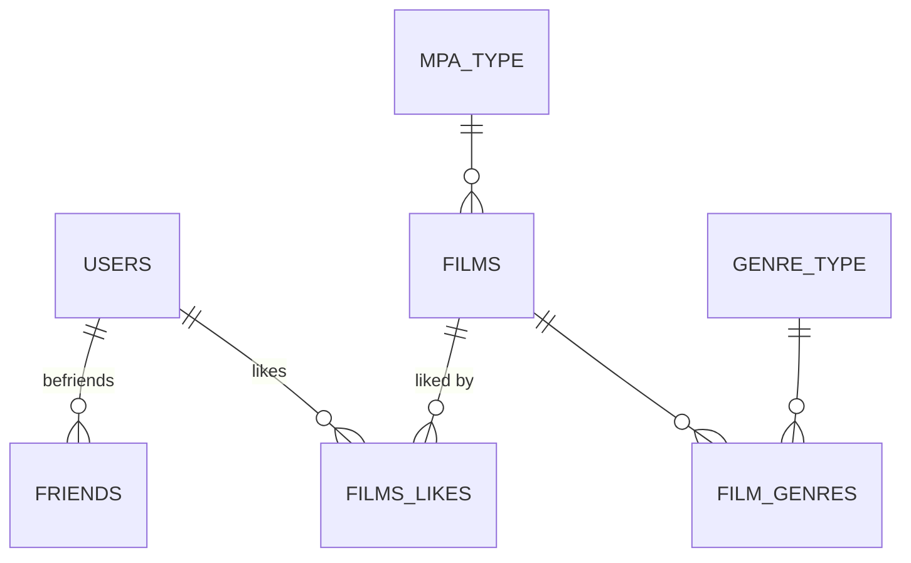

# Filmorate

> Film library REST API: films, likes, friends and a popular-films ranking.


[Русский](README.md) · **English**

## About

The backend of a social film service. Users add each other as friends, like films and get a list of popular films that can be filtered by genre and release year.

**Key decisions:**

- **Plain SQL instead of an ORM.** Data access is built on `JdbcTemplate` with custom `RowMapper`s and a base repository. Popularity is computed by a single SQL query that aggregates likes.
- **Normalized schema.** Seven tables: films, users, genre and MPA rating dictionaries, film–genre links, friendships and likes.
- **Custom validation.** The `@MinimumDate` annotation ensures a release date is not earlier than the first film screening (1895-12-28). Business checks live in service-layer predicates.
- **Configuration via environment.** The PostgreSQL connection comes from environment variables; tests use in-memory H2 with the same schema.

## Tech stack

| Area | Technologies |
| --- | --- |
| Language and framework | Java 21, Spring Boot 3.5 (Web, JDBC, Validation, Actuator) |
| Data | PostgreSQL, H2 (tests), SQL schema and seed scripts |
| Testing | JUnit 5, Spring Boot Test, Postman |
| Build | Maven, Lombok |

## Architecture

```text
src/main/java/ru/yandex/practicum/filmorate
├── controller/   # REST: films, users, genres, mpa
├── service/      # business logic and validation predicates
├── storage/      # JdbcTemplate repositories: film, user, friend, like, genre, mpa
├── mapper/       # a RowMapper per entity
├── model/        # Film, User, Genre, MPA, Like
└── validation/   # @MinimumDate annotation
```

## Database schema



## Quick start

Requires JDK 21 and PostgreSQL. The schema and dictionaries are created on startup from `schema.sql` and `data.sql`.

```bash
export DB_URL=jdbc:postgresql://localhost:5432/filmorate
export DB_USERNAME=postgres
export DB_PASSWORD=postgres
mvn spring-boot:run
```

API: http://localhost:8080

## API

| Resource | Endpoints |
| --- | --- |
| Films | `POST /films`, `PUT /films`, `GET /films`, `GET /films/{id}`, `DELETE /films/{id}` |
| Likes | `PUT /films/{id}/like/{userId}`, `DELETE /films/{id}/like/{userId}` |
| Popular | `GET /films/popular?count=&genreId=&year=` |
| Users | `POST /users`, `PUT /users`, `GET /users`, `GET /users/{id}`, `DELETE /users/{id}` |
| Friends | `PUT /users/{id}/friends/{friendId}`, `DELETE /users/{id}/friends/{friendId}`, `GET /users/{id}/friends`, `GET /users/{id}/friends/common/{otherId}` |
| Dictionaries | `GET /genres[/{id}]`, `GET /mpa[/{id}]` |

## Testing

```bash
mvn test
```

- **20 JUnit 5 tests:** controller and validation tests plus repository integration tests (`UserDaoTest`, `GenreRepositoryTest`) on H2.
- **Postman:** [collections](postman/) checking all endpoints.

## Author

**Andrew Burdak** — [GitHub](https://github.com/pochette) · [Telegram @burdak_aa](https://t.me/burdak_aa) · [burdak.andrew@gmail.com](mailto:burdak.andrew@gmail.com)
