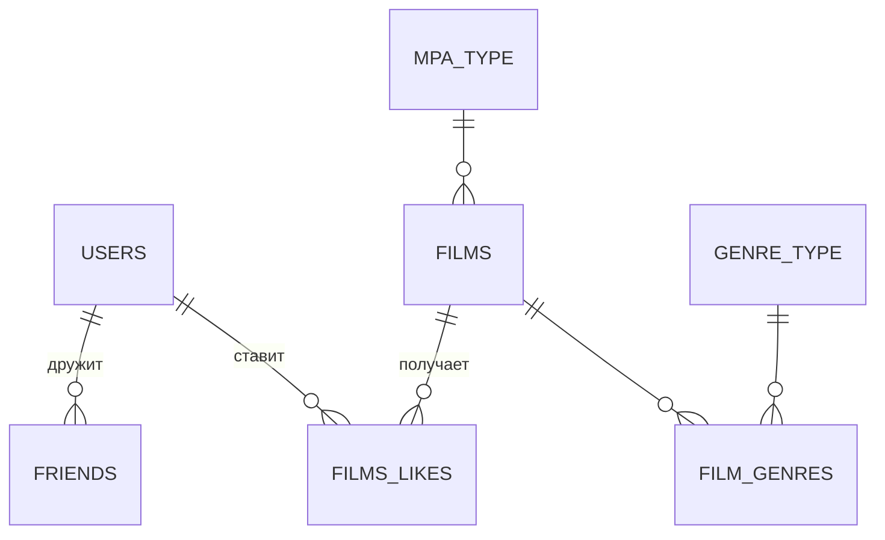

# Filmorate

> REST API фильмотеки: фильмы, лайки, друзья и рейтинг популярных фильмов.


**Русский** · [English](README.en.md)

## О проекте

Бэкенд социального сервиса о кино. Пользователи добавляют друг друга в друзья, ставят лайки фильмам и получают подборку популярных фильмов. Подборку можно отфильтровать по жанру и году выпуска.

**Ключевые решения:**

- **Чистый SQL вместо ORM.** Доступ к данным реализован на `JdbcTemplate` с собственными `RowMapper` и базовым репозиторием. Рейтинг популярности считается одним SQL-запросом с агрегацией лайков.
- **Нормализованная схема.** Семь таблиц: фильмы, пользователи, справочники жанров и рейтингов MPA, связи «фильм–жанр», дружба и лайки.
- **Собственная валидация.** Аннотация `@MinimumDate` проверяет, что дата релиза не раньше первого киносеанса (28.12.1895). Бизнес-проверки вынесены в предикаты сервисного слоя.
- **Конфигурация через окружение.** Подключение к PostgreSQL задаётся переменными окружения. Для тестов используется H2 в памяти с той же схемой.

## Стек

| Область | Технологии |
| --- | --- |
| Язык и фреймворк | Java 21, Spring Boot 3.5 (Web, JDBC, Validation, Actuator) |
| Данные | PostgreSQL, H2 (тесты), SQL-скрипты схемы и начальных данных |
| Тесты | JUnit 5, Spring Boot Test, Postman |
| Сборка | Maven, Lombok |

## Архитектура

```text
src/main/java/ru/yandex/practicum/filmorate
├── controller/   # REST: films, users, genres, mpa
├── service/      # бизнес-логика и предикаты валидации
├── storage/      # репозитории на JdbcTemplate: film, user, friend, like, genre, mpa
├── mapper/       # RowMapper для каждой сущности
├── model/        # Film, User, Genre, MPA, Like
└── validation/   # аннотация @MinimumDate
```

## Схема БД



## Быстрый старт

Нужны JDK 21 и PostgreSQL. Схема и справочники создаются при запуске из `schema.sql` и `data.sql`.

```bash
export DB_URL=jdbc:postgresql://localhost:5432/filmorate
export DB_USERNAME=postgres
export DB_PASSWORD=postgres
mvn spring-boot:run
```

API: http://localhost:8080

## API

| Ресурс | Эндпоинты |
| --- | --- |
| Фильмы | `POST /films`, `PUT /films`, `GET /films`, `GET /films/{id}`, `DELETE /films/{id}` |
| Лайки | `PUT /films/{id}/like/{userId}`, `DELETE /films/{id}/like/{userId}` |
| Популярное | `GET /films/popular?count=&genreId=&year=` |
| Пользователи | `POST /users`, `PUT /users`, `GET /users`, `GET /users/{id}`, `DELETE /users/{id}` |
| Друзья | `PUT /users/{id}/friends/{friendId}`, `DELETE /users/{id}/friends/{friendId}`, `GET /users/{id}/friends`, `GET /users/{id}/friends/common/{otherId}` |
| Справочники | `GET /genres[/{id}]`, `GET /mpa[/{id}]` |

## Тестирование

```bash
mvn test
```

- **21 тест** на JUnit 5: тесты контроллеров и валидации, а также интеграционные тесты репозиториев (`UserDaoTest`, `GenreRepositoryTest`) на H2.
- **Postman:** [коллекции](postman/) с проверками всех эндпоинтов.

## Автор

**Андрей Бурдак** — [GitHub](https://github.com/pochette) · [Telegram @burdak_aa](https://t.me/burdak_aa) · [burdak.andrew@gmail.com](mailto:burdak.andrew@gmail.com)
